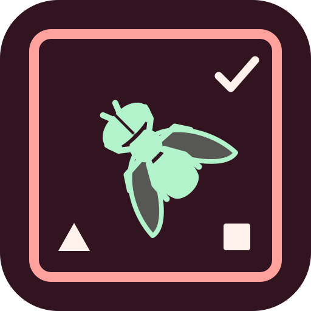
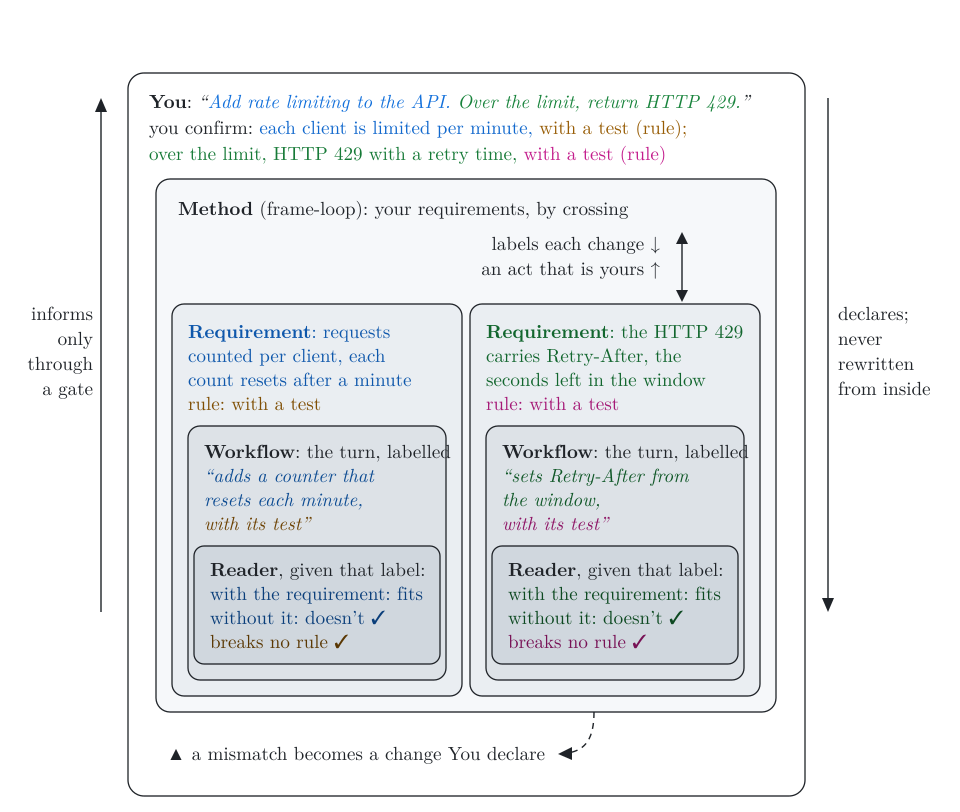

#  frame-loop

[](https://github.com/mirzahusadzic/claude-frame-loop/actions/workflows/ci.yml)
[](LICENSE)


[](https://doi.org/10.5281/zenodo.24044462)

Early alpha (0.1.5): used by its author so far; pin a version for stability. [Issues](https://github.com/mirzahusadzic/claude-frame-loop/issues).

A semantic workflow linter for Claude Code: your confirmed requirements and rules, checked every turn; only a mismatch reaches you. Checks run on [Gadfly](https://github.com/mirzahusadzic/gadfly): a fit counts only if it holds with the requirement and breaks without it ([paper](https://doi.org/10.5281/zenodo.23962158)).

<p align="center">
  <picture>
    <source media="(prefers-color-scheme: dark)" srcset="docs/images/frames-dark.svg">
    
  </picture>
</p>

<p align="center"><em>One request in nested frames: the rule guides the work and measures it. <a href="docs/rules.md#when-the-rules-act">When the rules act</a>.</em></p>

- **Frame 0:** your requirements, in your words, on your OK.
- **Free checks:** every turn; files, size, your confirmed rules; no model.
- **Reader:** on a signal only, under Gadfly's trials; a fit without your requirement is rejected.
- **A summary goes out:** Haiku, on your login, summarizes the change, told never to quote it; the reader (another model, Muse Spark) gets the summary and file names; secrets are refused. It may still carry private text. [Privacy](docs/privacy.md).
- **Authority:** pushes, releases, recursive deletes, the loop's own files: reported; in enforce mode, wait for your OK.
- **Live:** a band above the prompt.

---

### What you see

| Line | Means |
| --- | --- |
| `frame-loop ✓ checked: …` | fits; breaks no rule |
| `frame-loop ▲ needs you: <why>` | a mismatch, an unmet check, or an act of yours |
| `frame-loop ■ <why>` | not read; never a fit |
| `frame-loop · <act>` | an act reported; nothing read |

---

### Install

Needs: Claude Code (tested 2.1.319), git, Python 3.13 via uv; for the router, Node.js 20, the Codex CLI and an OpenRouter API key. The router serves both harnesses: Codex is set up alongside, on the same tiers. Details: [Setup](docs/setup.md).

```sh
npm install -g @openai/codex@0.166.0
git clone https://github.com/mirzahusadzic/unified-model-router.git
cd unified-model-router && node install.mjs && node install.mjs --verify && cd ..
uv tool install 'midwife>=0.13.1'
```

Gadfly: `midwife` 0.13.1 or later; the hooks run on its Python. The plugin, at a Claude Code prompt:

```text
/plugin marketplace add mirzahusadzic/claude-frame-loop
/plugin install frame-loop@claude-frame-loop
```

To update: `claude plugin marketplace update claude-frame-loop`, then `claude plugin update frame-loop@claude-frame-loop`, then `/reload-plugins` in each open session, or restart it; the next prompt brings the new briefing.

Allow the `contributor` tier (it trains on inputs) per project, in `.claude/settings.local.json`. A plain-words summary of each change goes to it, and may carry what the change holds:

```json
{
  "env": {
    "FRAME_LOOP_TRAINING_OK": "1"
  }
}
```

Private code: `"FRAME_LOOP_TIER": "private"` instead; keeps no data, costs more.

---

### Use

| To | Do |
| --- | --- |
| switch it off or on | `/frame-loop off`, `/frame-loop on` |
| see an outcome (shadow mode, the default) | send any prompt; **details** in the band |
| add a rule | state it; Claude offers the line for `AGENTS.md` |
| check the work is done | ask Claude |
| switch to enforce mode | `"FRAME_LOOP_MODE": "enforce"` in the same `env`; new session |

---

### Develop

No API key, no network; CI on macOS, Linux and Windows, Python 3.13 to 3.15; branch coverage held at 99%:

```sh
uv run --no-project --python 3.13 python -m unittest discover -s tests
claude plugin test .
sh scripts/coverage.sh
```

---

### Cite

The working paper on Zenodo describes the design and this plugin as built. The paper is under CC BY 4.0 and the code under Apache-2.0; the paper's DOI always resolves to its latest version:

```bibtex
@misc{husadzic2026holdingthread,
  author    = {Husadzic, Mirza},
  title     = {Holding the Thread: An Open Frame for Checking
               an Agent's Work Against the Person's Own Words},
  year      = {2026},
  publisher = {Zenodo},
  note      = {Working paper},
  doi       = {10.5281/zenodo.24044462},
  url       = {https://doi.org/10.5281/zenodo.24044462}
}
```

The method, Gadfly's paper:

```bibtex
@misc{husadzic2026loadbearing,
  author    = {Husadzic, Mirza},
  title     = {When Meaning Is Load-Bearing: Testing Whether
               a Decision Rests on Its Declared Evidence},
  year      = {2026},
  publisher = {Zenodo},
  note      = {Working paper},
  doi       = {10.5281/zenodo.23962158},
  url       = {https://doi.org/10.5281/zenodo.23962158}
}
```

---

[Quickstart](docs/quickstart.md) · [Verdicts](docs/verdicts.md) · [Crossings](docs/crossings.md) · [For agents](docs/agents.md) · [Recoil](docs/recoil.md) · [Architecture](docs/architecture.md) · [Roadmap](docs/roadmap.md) · [Contributing](CONTRIBUTING.md) · [Security](SECURITY.md)
