# Architecture

frame-loop runs as Claude Code hooks on the user's machine. Each turn's change passes the free checks; a signal sends a label, never code, through the privacy gate to the reader; fixed rules turn the reader's answers into one line. What leaves the machine is in [Privacy](privacy.md).

---

### To the reader

**Key:** 🟠 Claude Code · 🟢 frame-loop · 🔵 the reader · 🔴 refused, nothing sent.

```mermaid
---
config:
    layout: elk
    look: neo
    themeVariables:
        fontFamily: '-apple-system, BlinkMacSystemFont, "Segoe UI", "Noto Sans", Helvetica, Arial, sans-serif'
    flowchart:
        wrappingWidth: 220
        padding: 20
    themeCSS: >-
        foreignObject { overflow: visible; }
        [data-look="neo"] * { filter: none !important; }
        .node foreignObject, .node foreignObject *, .edgeLabel, .edgeLabel *,
        .cluster-label, .cluster-label * {
        font-family: -apple-system, BlinkMacSystemFont, "Segoe UI", "Noto Sans", Helvetica, Arial, sans-serif !important; line-height: 1.5 !important; }
        .node foreignObject, .node foreignObject * { white-space: nowrap !important; }
        code { font-family: ui-monospace, SFMono-Regular, "SF Mono", Menlo,
        Consolas, monospace; font-size: 0.9em; line-height: inherit;
        color: inherit !important; text-shadow: none !important;
        padding: 0 4px; border-radius: 4px;
        background: color-mix(in srgb, currentColor 14%, transparent)
        !important; }
        .edgeLabel, .edgeLabel p, .edgeLabel span {
        background: transparent !important; }
        .edgeLabel rect { fill: transparent !important; }
        .labelBkg { --knock: var(--vscode-editor-background,
        var(--bgColor-default, rgb(from currentColor
        clamp(30, (128 - r) * 100, 255) clamp(30, (128 - r) * 100, 255)
        clamp(30, (128 - r) * 100, 255)))); --ring: var(--knock);
        --fill: color-mix(in srgb, var(--ring) 30%, var(--knock));
        background: var(--fill) !important; border-radius: 4px;
        box-shadow: 0 0 0 5px var(--fill), 0 0 0 7px var(--ring); }
        .label[data-id^="L_CL_"] .labelBkg {
        --ring: #d97757; }
        .label[data-id^="L_PR_"] .labelBkg,
        .label[data-id^="L_FC_"] .labelBkg,
        .label[data-id^="L_GD_"] .labelBkg {
        --ring: #2e9e5b; }
        .label[data-id^="L_PG_RD_"] .labelBkg,
        .label[data-id^="L_RD_"] .labelBkg {
        --ring: #4d6bfe; }
        .label[data-id^="L_PG_NO_"] .labelBkg {
        --ring: #c94a4a; }
        .edgeLabel p, .edgeLabel span, .edgeLabel text {
        --halo: var(--fill, var(--vscode-editor-background,
        var(--bgColor-default,
        rgb(from currentColor clamp(0, (128 - r) * 100, 255)
        clamp(0, (128 - r) * 100, 255) clamp(0, (128 - r) * 100, 255)))));
        text-shadow: 1px 0 var(--halo), -1px 0 var(--halo),
        0 1px var(--halo), 0 -1px var(--halo), 1px 1px var(--halo),
        -1px -1px var(--halo), 1px -1px var(--halo), -1px 1px var(--halo),
        0 0 3px var(--halo), 0 0 4px var(--halo); }
---
flowchart LR
    CL["<b>A turn</b><br/>Claude edits the project"]
    FC["<b>Free checks</b><br/>snapshot, files, size,<br/>what the rules require"]
    PG["<b>Label and privacy gate</b><br/>Haiku labels the change;<br/>secrets refused,<br/>private names masked"]
    RD["<b>Reader</b><br/>Gadfly's trials, through the<br/>Unified Model Router on loopback,<br/>to your tier's model"]
    NO["<b>Not read</b><br/>nothing sent"]
    CL -->|"each turn"| FC
    FC -->|"on a signal"| PG
    PG -->|"label and file names"| RD
    PG --x|"a secret"| NO
    classDef default fill:#8a96a82e,stroke:#8a96a8,stroke-width:1px
    classDef claude fill:#d977574d,stroke:#d97757,stroke-width:2px
    classDef session fill:#d977570d,stroke:#d97757,stroke-width:1px
    classDef loop fill:#2e9e5b4d,stroke:#2e9e5b,stroke-width:2px
    classDef row fill:#2e9e5b0d,stroke:#2e9e5b,stroke-width:1px
    classDef reader fill:#4d6bfe4d,stroke:#4d6bfe,stroke-width:2px
    classDef refused fill:#c94a4a4d,stroke:#c94a4a,stroke-width:2px
    class CL claude
    class FC,PG loop
    class RD reader
    class NO refused
    linkStyle 3 stroke:#c94a4a,stroke-width:2px
```

---

### To Claude Code

```mermaid
---
config:
    layout: elk
    look: neo
    themeVariables:
        fontFamily: '-apple-system, BlinkMacSystemFont, "Segoe UI", "Noto Sans", Helvetica, Arial, sans-serif'
    flowchart:
        wrappingWidth: 220
        padding: 20
    themeCSS: >-
        foreignObject { overflow: visible; }
        [data-look="neo"] * { filter: none !important; }
        .node foreignObject, .node foreignObject *, .edgeLabel, .edgeLabel *,
        .cluster-label, .cluster-label * {
        font-family: -apple-system, BlinkMacSystemFont, "Segoe UI", "Noto Sans", Helvetica, Arial, sans-serif !important; line-height: 1.5 !important; }
        .node foreignObject, .node foreignObject * { white-space: nowrap !important; }
        code { font-family: ui-monospace, SFMono-Regular, "SF Mono", Menlo,
        Consolas, monospace; font-size: 0.9em; line-height: inherit;
        color: inherit !important; text-shadow: none !important;
        padding: 0 4px; border-radius: 4px;
        background: color-mix(in srgb, currentColor 14%, transparent)
        !important; }
        .edgeLabel, .edgeLabel p, .edgeLabel span {
        background: transparent !important; }
        .edgeLabel rect { fill: transparent !important; }
        .labelBkg { --knock: var(--vscode-editor-background,
        var(--bgColor-default, rgb(from currentColor
        clamp(30, (128 - r) * 100, 255) clamp(30, (128 - r) * 100, 255)
        clamp(30, (128 - r) * 100, 255)))); --ring: var(--knock);
        --fill: color-mix(in srgb, var(--ring) 30%, var(--knock));
        background: var(--fill) !important; border-radius: 4px;
        box-shadow: 0 0 0 5px var(--fill), 0 0 0 7px var(--ring); }
        .label[data-id^="L_CL_"] .labelBkg {
        --ring: #d97757; }
        .label[data-id^="L_PR_"] .labelBkg,
        .label[data-id^="L_FC_"] .labelBkg,
        .label[data-id^="L_GD_"] .labelBkg {
        --ring: #2e9e5b; }
        .label[data-id^="L_PG_RD_"] .labelBkg,
        .label[data-id^="L_RD_"] .labelBkg {
        --ring: #4d6bfe; }
        .label[data-id^="L_PG_NO_"] .labelBkg {
        --ring: #c94a4a; }
        .edgeLabel p, .edgeLabel span, .edgeLabel text {
        --halo: var(--fill, var(--vscode-editor-background,
        var(--bgColor-default,
        rgb(from currentColor clamp(0, (128 - r) * 100, 255)
        clamp(0, (128 - r) * 100, 255) clamp(0, (128 - r) * 100, 255)))));
        text-shadow: 1px 0 var(--halo), -1px 0 var(--halo),
        0 1px var(--halo), 0 -1px var(--halo), 1px 1px var(--halo),
        -1px -1px var(--halo), 1px -1px var(--halo), -1px 1px var(--halo),
        0 0 3px var(--halo), 0 0 4px var(--halo); }
---
flowchart LR
    CL["<b>Claude</b><br/>a tool call"]
    FC["<b>Free checks</b><br/>no signal"]
    RD["<b>Reader</b><br/>answers per trial"]
    subgraph FL["frame-loop, on this machine"]
        direction TB
        GD["<b>Guard</b><br/>acts that are yours"]
        GT["<b>Gate</b><br/>fixed rules"]
    end
    OUT["<b>Claude Code</b><br/>a hook message under the reply,<br/>the band above the prompt:<br/>✓ fits · ▲ needs you · ■ not read"]
    CL -->|"push, release, delete,<br/>frame 0 or loop files"| GD
    RD -->|"answers"| GT
    FC -->|"✓"| OUT
    GT --> OUT
    GD --> OUT
    classDef default fill:#8a96a82e,stroke:#8a96a8,stroke-width:1px
    classDef claude fill:#d977574d,stroke:#d97757,stroke-width:2px
    classDef session fill:#d977570d,stroke:#d97757,stroke-width:1px
    classDef loop fill:#2e9e5b4d,stroke:#2e9e5b,stroke-width:2px
    classDef row fill:#2e9e5b0d,stroke:#2e9e5b,stroke-width:1px
    classDef reader fill:#4d6bfe4d,stroke:#4d6bfe,stroke-width:2px
    classDef refused fill:#c94a4a4d,stroke:#c94a4a,stroke-width:2px
    class CL claude
    class FC,GD,GT loop
    class FL row
    class RD reader
```

---

### Parts

| Part | Runs | Reads | Produces |
| --- | --- | --- | --- |
| Snapshot | each prompt | the working tree, tracked and untracked | a git tree, through the loop's own index; your index is never touched |
| Free checks | each turn's end | the diff between the turn's first snapshot and now | files, size, the checks the rules require, and the signals |
| Writer | on a signal, with labels on | the change, without the requirements Claude named, ids masked | a plain-words label, by Haiku through `claude -p` on your login |
| Privacy gate | before any call | the label and file names | refuses secrets and lines read from outside the project; masks private names |
| Reader | each read | frame 0, the rules, the label | answers to Gadfly's trials: baseline, repeat, the requirement removed, a harmless line removed, every requirement removed, the requirement reversed |
| Gate | after the reader | the answers | ✓, ▲ or ■, by fixed rules |
| Guard | each tool call | the command or the file | an act that is yours, on the line |
| Band | while a read runs | `~/.claude/frame-loop/live/<session>.json` | the step, the answers so far, the time left, then the outcome |

---

### Hooks

| Claude Code event | frame-loop |
| --- | --- |
| `SessionStart` | briefs Claude: frame 0, the rules, the markers |
| `UserPromptSubmit` | takes the snapshot; tells Claude what the last turn's check found |
| `PreToolUse` | the guard; reads Claude's markers; checks a node file before it is written; reads a plan on leaving plan mode |
| `PostToolUse` | records lines read from outside the project, and the commands the rules ask for |
| `Stop` | the free checks, then the read on a signal; the line |

---

### A reading

The reader is asked questions, never Claude's opinion of its own work. Fixed rules in `frameloop/gate.py` read the answers.

| Question | Trials | Rule |
| --- | --- | --- |
| which requirement does the change fulfil? | baseline, repeat, the declared requirement removed, a harmless line removed, every requirement removed, the requirement reversed | ✓ only if it rests on the declared requirement: a fit that holds without it, or names another requirement, is ▲ |
| does it break a rule? | baseline, repeat | ✓ if neither names a rule; ▲ naming the rule if both name it; ▲ if they disagree |
| what is it for? (no requirement declared) | baseline, repeat | never ✓: declare it, a missing requirement, or padding |
| is the requirement done? (completion) | Gadfly's firm runs over the claiming steps | ✓ only if carried (the answer moves when the requirement is removed) and firm (more runs would not change it) |

A refused or failed reading is "not read", never a fit. Effort rises for risky changes (a deletion, a dependency, the loop's settings, a large diff), never falls below the user's floor.
