# Architecture

frame-loop runs as Claude Code hooks on the user's machine. Each turn's change passes the free checks; a signal sends a label through the privacy gate to the reader; fixed rules turn the reader's answers into a verdict, and only what needs the user is printed. What leaves the machine is in [Privacy](privacy.md).

---

### To the reader

**Key:** 🟠 orange, Claude Code · 🟢 green, frame-loop · 🔵 blue, the reader · 🔴 red, refused, nothing sent.

```mermaid
---
config:
    layout: elk
    look: neo
    themeVariables:
        fontFamily: '-apple-system, BlinkMacSystemFont, "Segoe UI", "Noto Sans", Helvetica, Arial, sans-serif'
    flowchart:
        wrappingWidth: 220
        padding: 20
    themeCSS: >-
        foreignObject { overflow: visible; }
        [data-look="neo"] * { filter: none !important; }
        .node foreignObject, .node foreignObject *, .edgeLabel, .edgeLabel *,
        .cluster-label, .cluster-label * {
        font-family: -apple-system, BlinkMacSystemFont, "Segoe UI", "Noto Sans", Helvetica, Arial, sans-serif !important; line-height: 1.5 !important; }
        .node foreignObject, .node foreignObject * { white-space: nowrap !important; }
        code { font-family: ui-monospace, SFMono-Regular, "SF Mono", Menlo,
        Consolas, monospace; font-size: 0.9em; line-height: inherit;
        color: inherit !important; text-shadow: none !important;
        padding: 0 4px; border-radius: 4px;
        background: color-mix(in srgb, currentColor 14%, transparent)
        !important; }
        .edgeLabel, .edgeLabel p, .edgeLabel span {
        background: transparent !important; }
        .edgeLabel rect { fill: transparent !important; }
        .labelBkg { --knock: var(--vscode-editor-background,
        var(--bgColor-default, rgb(from currentColor
        clamp(30, (128 - r) * 100, 255) clamp(30, (128 - r) * 100, 255)
        clamp(30, (128 - r) * 100, 255)))); --ring: var(--knock);
        --fill: color-mix(in srgb, var(--ring) 30%, var(--knock));
        background: var(--fill) !important; border-radius: 4px;
        box-shadow: 0 0 0 5px var(--fill), 0 0 0 7px var(--ring); }
        .label[data-id^="L_CL_"] .labelBkg {
        --ring: #d97757; }
        .label[data-id^="L_PR_"] .labelBkg,
        .label[data-id^="L_FC_"] .labelBkg,
        .label[data-id^="L_GD_"] .labelBkg {
        --ring: #2e9e5b; }
        .label[data-id^="L_PG_RD_"] .labelBkg,
        .label[data-id^="L_RD_"] .labelBkg {
        --ring: #4d6bfe; }
        .label[data-id^="L_PG_NO_"] .labelBkg {
        --ring: #c94a4a; }
        .edgeLabel p, .edgeLabel span, .edgeLabel text {
        --halo: var(--fill, var(--vscode-editor-background,
        var(--bgColor-default,
        rgb(from currentColor clamp(0, (128 - r) * 100, 255)
        clamp(0, (128 - r) * 100, 255) clamp(0, (128 - r) * 100, 255)))));
        text-shadow: 1px 0 var(--halo), -1px 0 var(--halo),
        0 1px var(--halo), 0 -1px var(--halo), 1px 1px var(--halo),
        -1px -1px var(--halo), 1px -1px var(--halo), -1px 1px var(--halo),
        0 0 3px var(--halo), 0 0 4px var(--halo); }
---
flowchart LR
    CL["<b>A turn</b><br/>Claude edits the project"]
    FC["<b>Free checks</b><br/>snapshot, files, size,<br/>what the rules require"]
    PG["<b>Label and privacy gate</b><br/>Haiku labels the change;<br/>secrets refused,<br/>private names masked"]
    RD["<b>Reader</b><br/>Gadfly's trials, through the<br/>Unified Model Router on loopback,<br/>to your tier's model"]
    NO["<b>Not read</b><br/>nothing sent"]
    CL -->|"each turn"| FC
    FC -->|"on a signal"| PG
    PG -->|"label and file names,<br/>with frame 0 and the rules"| RD
    PG --x|"a secret, or no label"| NO
    classDef default fill:#8a96a82e,stroke:#8a96a8,stroke-width:1px
    classDef claude fill:#d977574d,stroke:#d97757,stroke-width:2px
    classDef session fill:#d977570d,stroke:#d97757,stroke-width:1px
    classDef loop fill:#2e9e5b4d,stroke:#2e9e5b,stroke-width:2px
    classDef row fill:#2e9e5b0d,stroke:#2e9e5b,stroke-width:1px
    classDef reader fill:#4d6bfe4d,stroke:#4d6bfe,stroke-width:2px
    classDef refused fill:#c94a4a4d,stroke:#c94a4a,stroke-width:2px
    class CL claude
    class FC,PG loop
    class RD reader
    class NO refused
    linkStyle 3 stroke:#c94a4a,stroke-width:2px
```

---

### To Claude Code

```mermaid
---
config:
    layout: elk
    look: neo
    themeVariables:
        fontFamily: '-apple-system, BlinkMacSystemFont, "Segoe UI", "Noto Sans", Helvetica, Arial, sans-serif'
    flowchart:
        wrappingWidth: 220
        padding: 20
    themeCSS: >-
        foreignObject { overflow: visible; }
        [data-look="neo"] * { filter: none !important; }
        .node foreignObject, .node foreignObject *, .edgeLabel, .edgeLabel *,
        .cluster-label, .cluster-label * {
        font-family: -apple-system, BlinkMacSystemFont, "Segoe UI", "Noto Sans", Helvetica, Arial, sans-serif !important; line-height: 1.5 !important; }
        .node foreignObject, .node foreignObject * { white-space: nowrap !important; }
        code { font-family: ui-monospace, SFMono-Regular, "SF Mono", Menlo,
        Consolas, monospace; font-size: 0.9em; line-height: inherit;
        color: inherit !important; text-shadow: none !important;
        padding: 0 4px; border-radius: 4px;
        background: color-mix(in srgb, currentColor 14%, transparent)
        !important; }
        .edgeLabel, .edgeLabel p, .edgeLabel span {
        background: transparent !important; }
        .edgeLabel rect { fill: transparent !important; }
        .labelBkg { --knock: var(--vscode-editor-background,
        var(--bgColor-default, rgb(from currentColor
        clamp(30, (128 - r) * 100, 255) clamp(30, (128 - r) * 100, 255)
        clamp(30, (128 - r) * 100, 255)))); --ring: var(--knock);
        --fill: color-mix(in srgb, var(--ring) 30%, var(--knock));
        background: var(--fill) !important; border-radius: 4px;
        box-shadow: 0 0 0 5px var(--fill), 0 0 0 7px var(--ring); }
        .label[data-id^="L_CL_"] .labelBkg {
        --ring: #d97757; }
        .label[data-id^="L_PR_"] .labelBkg,
        .label[data-id^="L_FC_"] .labelBkg,
        .label[data-id^="L_GD_"] .labelBkg,
        .label[data-id^="L_GT_"] .labelBkg {
        --ring: #2e9e5b; }
        .label[data-id^="L_PG_RD_"] .labelBkg,
        .label[data-id^="L_RD_"] .labelBkg {
        --ring: #4d6bfe; }
        .label[data-id^="L_PG_NO_"] .labelBkg {
        --ring: #c94a4a; }
        .edgeLabel p, .edgeLabel span, .edgeLabel text {
        --halo: var(--fill, var(--vscode-editor-background,
        var(--bgColor-default,
        rgb(from currentColor clamp(0, (128 - r) * 100, 255)
        clamp(0, (128 - r) * 100, 255) clamp(0, (128 - r) * 100, 255)))));
        text-shadow: 1px 0 var(--halo), -1px 0 var(--halo),
        0 1px var(--halo), 0 -1px var(--halo), 1px 1px var(--halo),
        -1px -1px var(--halo), 1px -1px var(--halo), -1px 1px var(--halo),
        0 0 3px var(--halo), 0 0 4px var(--halo); }
---
flowchart LR
    CL["<b>Claude</b><br/>a tool call"]
    FC["<b>Free checks</b><br/>no signal"]
    RD["<b>Reader</b><br/>answers per trial"]
    subgraph FL["frame-loop, on this machine"]
        direction TB
        GD["<b>Guard</b><br/>acts that are yours"]
        GT["<b>Gate</b><br/>fixed rules"]
    end
    OUT["<b>Claude Code</b><br/>a hook message under the reply,<br/>the band above the prompt:<br/>▲ needs you · ■ not read"]
    REC["<b>The record</b><br/>kept in the project; Claude hears at the<br/>next prompt what rose, what did not<br/>settle and the acts"]
    CL -->|"push, release, delete,<br/>frame 0 or loop files"| GD
    RD -->|"answers"| GT
    FC -->|"no reading"| REC
    GT -->|"▲ ■"| OUT
    GD -->|"▲"| OUT
    GT -->|"every verdict"| REC
    GD -->|"every act"| REC
    classDef default fill:#8a96a82e,stroke:#8a96a8,stroke-width:1px
    classDef claude fill:#d977574d,stroke:#d97757,stroke-width:2px
    classDef session fill:#d977570d,stroke:#d97757,stroke-width:1px
    classDef loop fill:#2e9e5b4d,stroke:#2e9e5b,stroke-width:2px
    classDef row fill:#2e9e5b0d,stroke:#2e9e5b,stroke-width:1px
    classDef reader fill:#4d6bfe4d,stroke:#4d6bfe,stroke-width:2px
    classDef refused fill:#c94a4a4d,stroke:#c94a4a,stroke-width:2px
    class CL claude
    class FC,GD,GT loop
    class FL row
    class RD reader
```

---

### Parts

| Part | Runs | Reads | Produces |
| --- | --- | --- | --- |
| Snapshot | each prompt | the working tree, tracked and untracked | a git tree, through the loop's own index; your index is never touched |
| Free checks | each turn's end | the diff between the turn's first snapshot and now | files, size, the checks the rules require, and the signals |
| Writer | before each read, with labels on | the change, Claude's declaration cut and frame 0's ids masked | a plain-words label, by Haiku through `claude -p` on your login |
| Privacy gate | before any call | the change before the writer; then the label and file names | refuses secrets; masks private names; takes ids and a requirement's words out of the label |
| Reader | each read | frame 0, the rules, the label and file names | answers to Gadfly's trials: baseline, repeat, the requirement removed, a harmless line removed, every requirement removed, the requirement reversed |
| Gate | after the reader | the answers | ✓, ▲, ■ or not settled, by fixed rules |
| Guard | each shell or edit call | the command or the file | an act that is yours, in the record; in enforce mode, a question first |
| Band | while a read runs, then until the next prompt | `~/.claude/frame-loop/live/<session>.json` | one line: what is happening now, the time left, the tokens spent; then a ▲ or a ■, with **details** |

---

### Hooks

| Claude Code event | frame-loop |
| --- | --- |
| `SessionStart`, on startup, resume, clear and compact | briefs Claude: frame 0, the rules, the markers |
| `UserPromptSubmit` | takes the snapshot; tells Claude what the last turn's check found and which acts it recorded; reminds Claude once of the end-of-work check; briefs again after a reload or `/frame-loop on` |
| `PreToolUse`, on `ExitPlanMode`, `Bash` and the edit tools | the guard; reads Claude's markers; checks a node file or the rules index before it is written; hashes the loop's files before a shell call; reads a plan on leaving plan mode |
| `PostToolUse`, on `Bash` | records the commands the rules ask for that passed and the acts that ran, and reports a change to the loop's files |
| `PostToolUseFailure`, on `Bash` | records the commands the rules ask for that failed, and reports a change to the loop's files |
| `Stop` | the free checks, then the read on a signal, in the background in shadow mode; a line only for what needs the user |

---

### A reading

The reader is asked questions, never Claude's opinion of its own work. Fixed rules in `frameloop/gate.py` read the answers.

| Question | Trials | Rule |
| --- | --- | --- |
| which requirement does the change fulfil? | baseline, repeat, the declared requirement removed, a harmless line removed (when a requirement is left undeclared; with every one declared, nothing is), every requirement removed, the requirement reversed | ✓ only if it rests on the declared requirement: a fit that holds without it, or names another requirement, is ▲; answers that do not settle show nothing and go to Claude alone |
| does it break a rule? (with rules indexed) | baseline, repeat | ✓ if both read none; ▲ naming the rule if both name it; not settled if they disagree |
| what is it for? (no requirement declared) | baseline, repeat | when both name one requirement, the two questions above test it as if declared; otherwise never ✓: a missing requirement or padding is ▲, and a disagreement is not settled |
| is the requirement done? (completion, of the requirements the work claimed; of all of them only when the user asks about the whole frame) | Gadfly's firm runs over the claiming steps, or all of the session's steps when only a declaration claims it | ✓ only if carried (the answer moves when those steps are removed) and firm (more runs would not change it); ▲ on a firm miss or a requirement not read; when all that is left did not settle, nothing shows and Claude alone is told |

A change gets one round of answers, and whether a requirement is done up to two. What a change's round leaves unsettled goes to Claude with the split, not back to the reader: Claude has the diff, and its look never turns the reading into a pass.

The reader is not asked twice about one change. In a session, a reading of the same final tree and frame 0, on the same reader, at least as hard and about the same requirements and files is reused, and the free checks still run. A turn's end can lean on a wider reading; a reading Claude asks for leans only on the very same diff, and stops a background read it covers. A reading that failed is never reused. A reading also stops at its token cap, and is then "not read".

A refused or failed reading is "not read", never a fit. Effort rises for risky changes (a deletion, a dependency, the loop's settings, a large diff), never falls below the user's floor.
