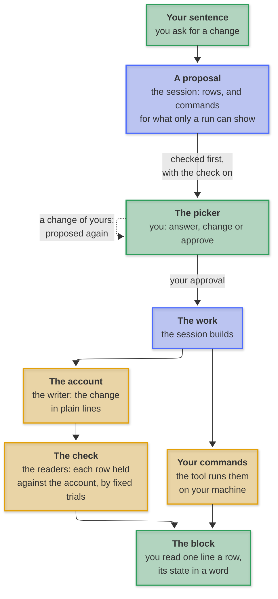

# The check

What is checked and when, who reads what, the trials a row goes through, and each state it can come back in. The check has two moments, a proposal before you approve it and the work at the end of each turn, and one switch turns both on. [The words](words.md) says in a line or two what each of the tool's own words means.

---

### The loop

One loop carries a request from your sentence to the block you read. Everything the tool checks hangs on it.

*The loop: your sentence becomes rows you approve, the work is described and read against them, and each row comes back with its state.*

The dashed loop is a change of yours: the session proposes again, and nothing is approved meanwhile. The account and the check run only with the check on, and your commands run either way.

---

### Before you approve

With the check on, a proposal is checked as soon as it is kept. The picker shows a running line until the check ends, then gives each row its status.

- **Each row alone.** The maker takes the row apart from its words alone, and takes apart the same row turned around, "It is not so that…", made by code. Readers then say whether the row is clear on its own.
- **Seen or not.** For a row seen in the work, readers say whether a person could see it for themselves. A firm no asks you whether it should have a command ([two roads](rows.md#two-roads)).
- **A crossing.** Readers say whether the parts' rows carry each row above, with each part taken away in turn. So the check can name the parts a row needs, and one it holds without.
- **A contract.** It is read against the rows on both its sides.
- **A row at a part.** A proposal for one part is read with the row above it, against this proposal's rows beside those of the other parts.

The check never approves a proposal. It marks what you may need to answer, and you approve in the picker; no model and no script can take that place.

---

### At a turn's end

The hooks snapshot the project when a turn begins and when it ends. Only places that changed are read, with any row an earlier failed check still owes.

1. **The account.** The writer describes the change in numbered lines, each one thing the change makes the software do.
2. **What each line is for.** Readers say which of your rows each line serves. A line that serves none is counted as extra, and one they do not settle is told to the session alone.
3. **Each row.** Each open row of yours at a changed place is read against the lines that serve it, with the step kept at approval, so the maker is not asked again. A row with no line of its own is "not seen", and no reader is asked.
4. **Your commands.** A command runs where the change touched its place, in the time the check left, and a path rule is held against every change. A contract's check runs where either of its sides changed.

A row whose last check still stands on the same work is not read again. A row above a crossing is not read at all: it passes with its parts' rows ([a crossing](rows.md#a-crossing)).

---

### Who does what

Three kinds of model are asked, and each sees only the part its job needs. So no one of them says both what changed and whether it meets a row.

| Who | Is sent | Gives back |
| --- | --- | --- |
| The writer | The change, with known secrets cut; never your rows | The account |
| The maker | One row's words alone | A step: what the row's words must mean, what must be shown, what would show it unmet |
| The readers | The step, the account and the row; never the code | `yes`, `no` or `unclear` |

Gadfly runs the trials and keeps their records, and reading kept records again costs no model call. [Privacy](privacy.md#what-leaves-the-machine) has which model stands behind each name in each tier.

---

### The trials

A reading asks the same question several fixed ways. The answers together decide, never one of them.

| Trial | What is asked | What a pass needs |
| --- | --- | --- |
| As it is | The row, its step and the account as they stand | Yes |
| Again | The same, a second time | The same answer |
| Its own lines cut | The account without the lines that serve the row | No longer a yes |
| Other lines cut in their stead | The account without as many lines that serve other rows or none, where there are so many | Still a yes |
| The row turned around | "It is not so that…", against a step of its own | A no |

A pass also needs the readers to agree firmly across repeated calls. A row with no turned-around form kept can be "not sure" at most, and so can a row whose only lines come from a session's notice.

---

### What a pass rests on

A pass is kept with its trials, the work it read, the step it used and the records of every call. At each session's start and each turn's end the tool reads that evidence again, with no model.

The records must lie in a run's own folder of the machine folder and hold the digest the pass names. They must be of the same row, place, step and work, and hold an answer to every trial the outcome needs.

Where any of it no longer stands, the row is not passed, and you are told once. So a pass cannot be written by hand, and it does not outlive a change to its work.

---

### What a row can come back as

The block at a turn's end gives each row one state, in a word. Every state but `passed` comes with its reason.

| State | What it means |
| --- | --- |
| `passed` | The readers agreed firmly that the account shows the row, and every trial came out as a pass needs. |
| `missing` | The change speaks against the row. |
| `not sure` | The trials did not show that the row rests on the change, or the readers did not agree. |
| `not seen` | Nothing in the account speaks to the row yet. |
| `not checked` | The check could not run, and the line says why: no step, no work at its place, not approved, no time left, the check off, or a failure such as a missing `gadfly`. |

A row that a command checks has states of its own:

| State | What it means |
| --- | --- |
| `holds` | The command ran and passed, or no forbidden path was touched. |
| `failed` | The command ran and did not pass, or a forbidden path was touched. |
| `timed out`, `not started`, `not run` | The command did not finish, could not start, or had no time left. |

`extra` is no state of a row. It counts the account's lines that serve none of your rows.

---

### When the check cannot run

A check that cannot run is told as a failure, with its reason. It is never passed over in silence.

- **Before you approve.** The picker says so in one line and offers to check again. Approval is not offered while it stands, and you can still close the picker or send a change.
- **At a turn's end.** The row is `not checked` with the reason, which the line above the prompt shows as an alert. The check is owed, and the next turn's end runs it again, whether or not its place changed.
- **With the check off.** No proposal is checked and no row is read, and a check owed waits until it is on. Your commands, path rules and contracts' checks still run, since they run on your machine.
